#  eDash

[](https://github.com/PossenigM/edash/actions/workflows/ci.yml)

E-ink office dashboard based on a Raspberry Pi Zero 2 W and a Waveshare 7.5" e-paper
panel. The display is connected to a laptop by a single USB cable, which supplies
power and carries the data. No network connection is required on the Pi.

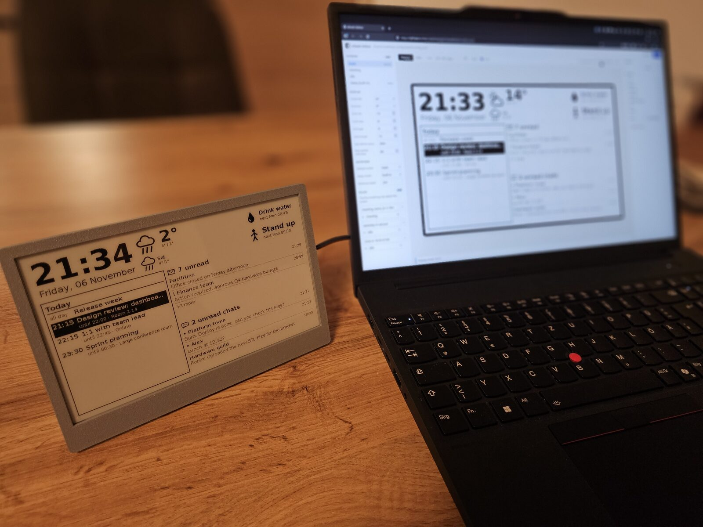

## Features

- Clock, weather, calendar, next meeting, unread mail, Teams chats and recurring reminders
- Layout defined in one YAML file: widgets, positions, sizes and multiple screens
- Browser-based layout editor with live preview and drag-and-drop placement
- Rule-based screen rotation, e.g. a meeting screen five minutes before a meeting starts
- Away screen when the laptop is locked, suspended or shut down
- Outdated data is marked with its fetch time
- Partial refresh for regular updates, periodic full refresh against ghosting
- English and German display language
- Laptop host for Windows and Linux; data from Microsoft Graph and Open-Meteo
- Read-only root file system on the Pi, safe against power loss

## Architecture

```
Laptop: edash-host                          USB serial (CDC-ACM)         Pi: edash-device
  config.yaml ─┐                         ─── config, time, data ──►        state (RAM only)
  Graph (mail, calendar, Teams chats)    ◄── hello, acks, errors ──        screen rules
  Open-Meteo (weather)                                                     renderer + widgets
  tray / `edash-host ctl`                                                  e-ink driver
```

The Pi runs as a USB gadget with two CDC-ACM serial ports: one for the application
protocol, one for a login console. The host fetches data, pushes the configuration
and sends JSON messages. The Pi renders all screens itself, so the clock and reminders
keep running between data updates. Host and device share the rendering code, so
`edash-host preview` produces the same image as the panel.

## Hardware

| Part | Notes |
|---|---|
| Raspberry Pi Zero 2 W | With GPIO pin header (Zero 2 WH or soldered); uses USB device mode on the micro-USB data port |
| Waveshare 7.5" e-Paper HAT (V2) | 800×480, black/white, driver `epd7in5_V2`; the driver board sits next to the Pi and connects with the supplied 8-wire cable |
| microSD card | 8 GB or more |
| Micro-USB data cable | Connects the Pi's **USB** port (not PWR) to the laptop |
| Enclosure | 3D-printed front panel, back plate, cover and kickstand; four threaded inserts and screws hold the cover |

Measured on the V2 panel: full refresh 4.1 s, partial refresh 0.7 s.

| | | |
|---|---|---|
| 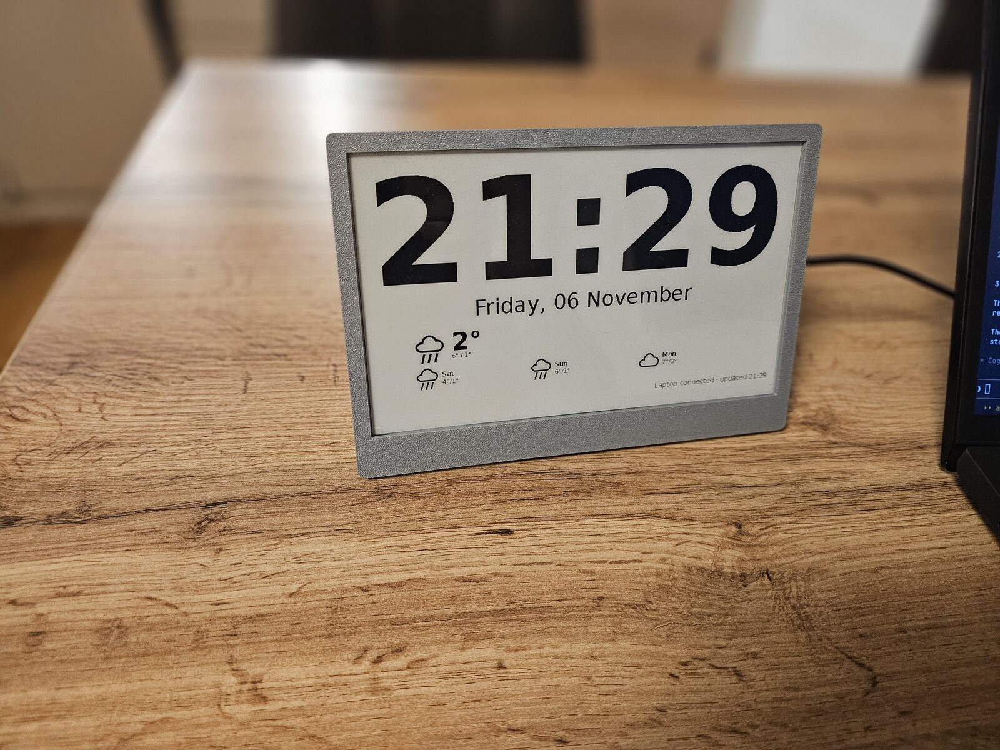 | 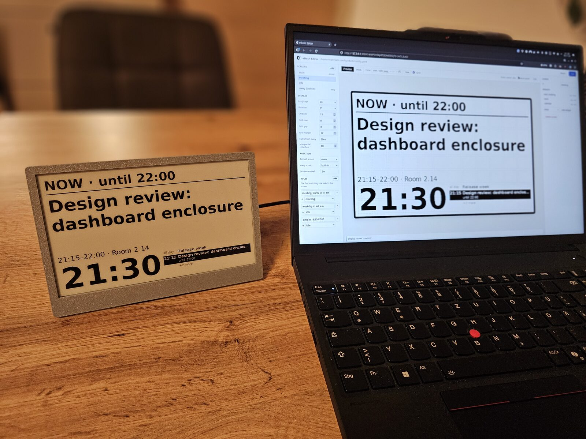 | 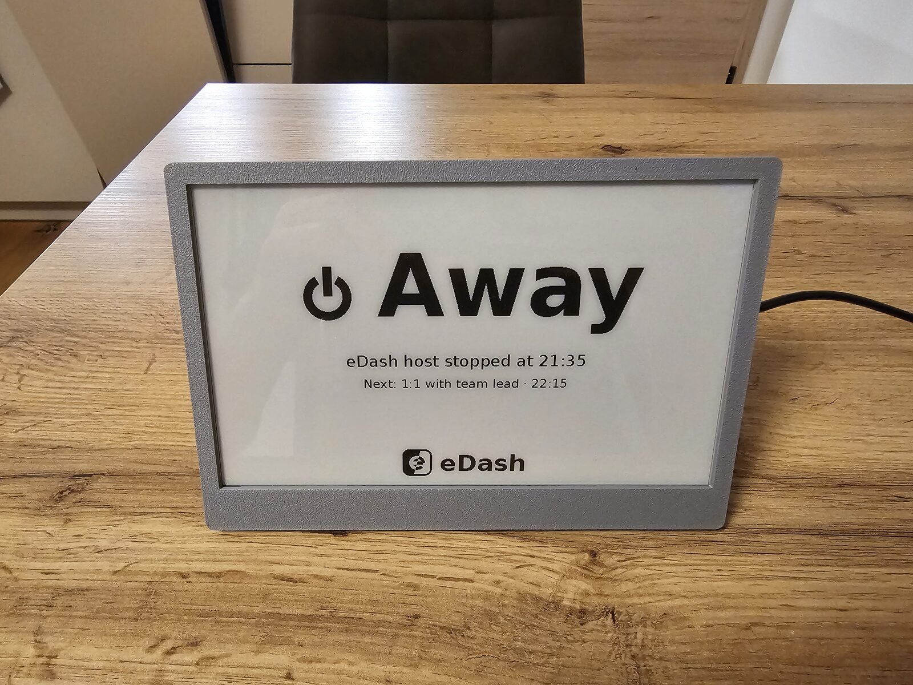 |
| Idle screen | Meeting screen | Away screen |
| 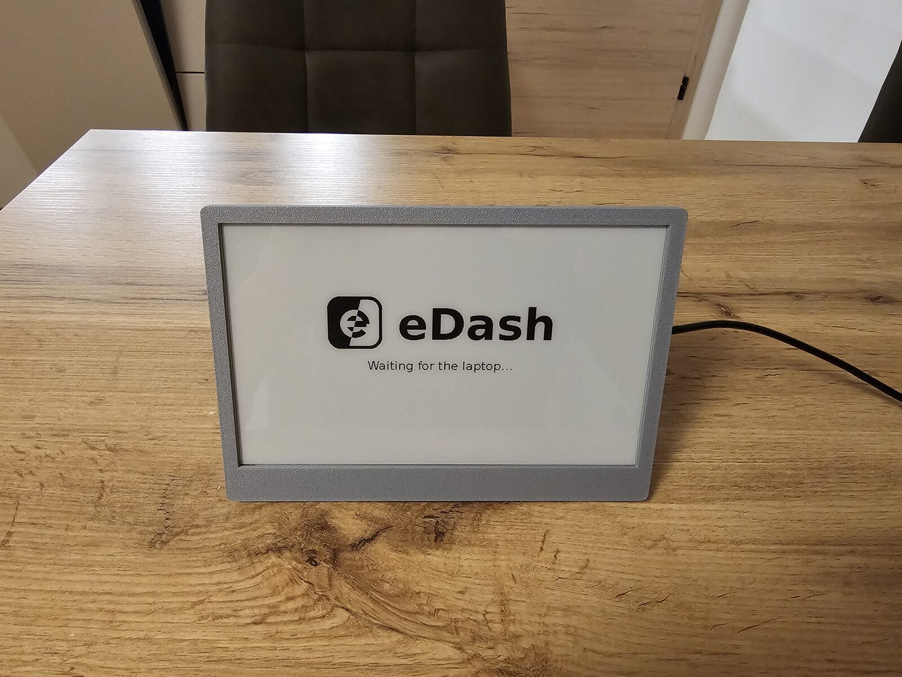 | 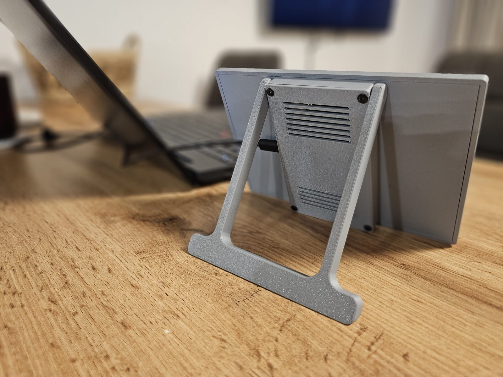 | 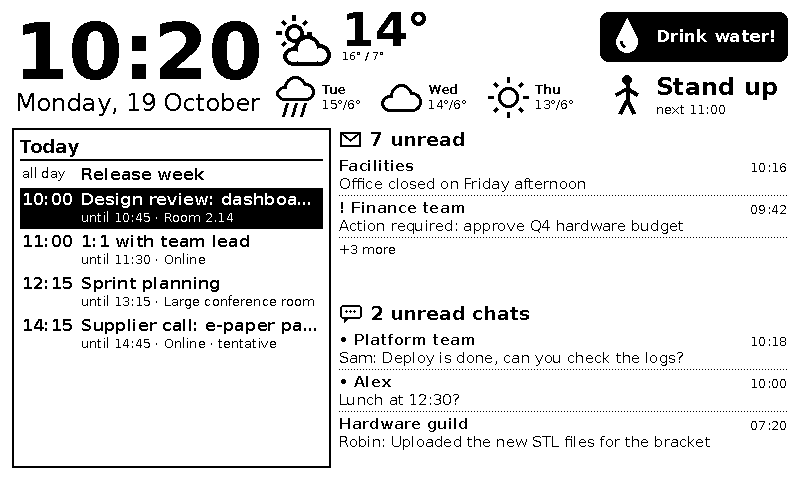 |
| Startup screen | Back with kickstand | Rendered main screen (800×480) |
| 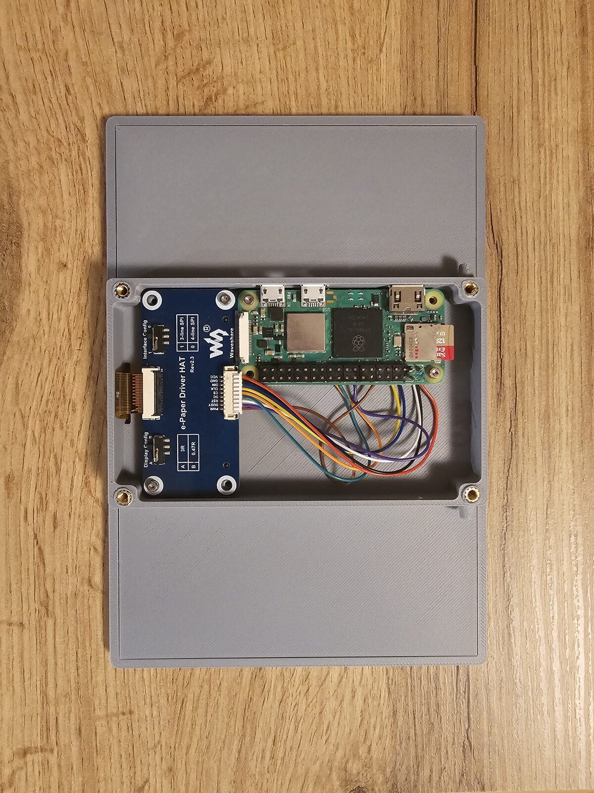 | 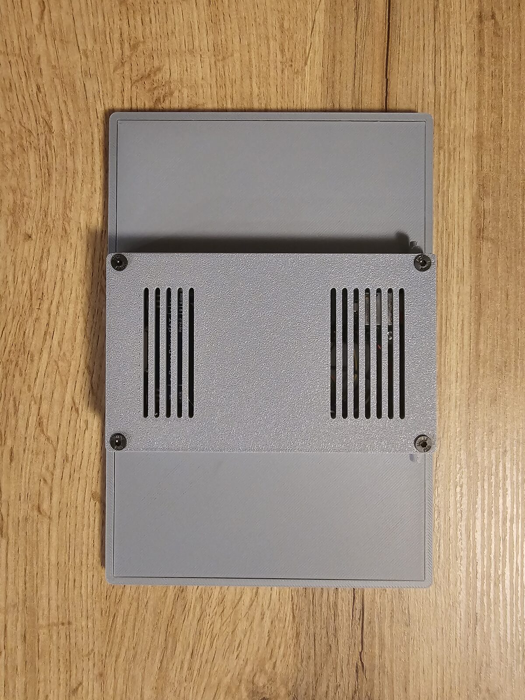 | 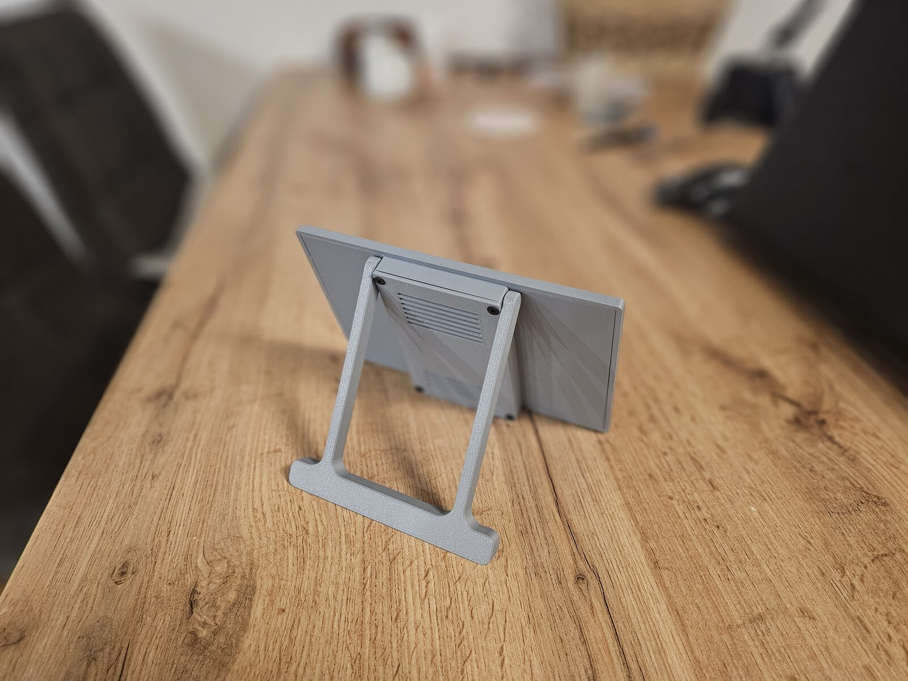 |
| Pi and driver board in the back plate | Vented cover | Kickstand |

## Quick start

Render the example screens without any hardware:

```sh
python -m venv .venv
.venv/bin/pip install -e ".[host,dev]"
.venv/bin/edash-host preview --config src/edash/assets/config.example.yaml --scale 2
```

`edash-host edit` opens the layout editor in the browser:

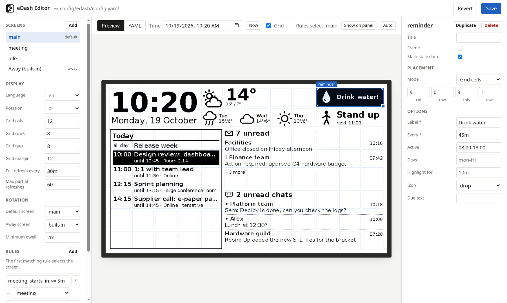

With the Pi connected,
`edash-host run --demo` drives the panel with live weather and sample mail, calendar
and Teams data, without a Microsoft 365 account.

## Documentation

- [Pi setup](docs/pi-setup.md): installation, self-test, lockdown, debug console, updates
- [Host setup](docs/host-setup.md): Windows and Linux host, Microsoft Graph, CLI
- [Configuration](docs/configuration.md): layout, widgets, screen rules, language
- [Development](docs/development.md): repository layout, protocol, tests, adding widgets

## License

[MIT](LICENSE)

## Status

Tested with a Linux host and demo data. Not yet tested: Windows host on real hardware,
Microsoft Graph against a production tenant.
