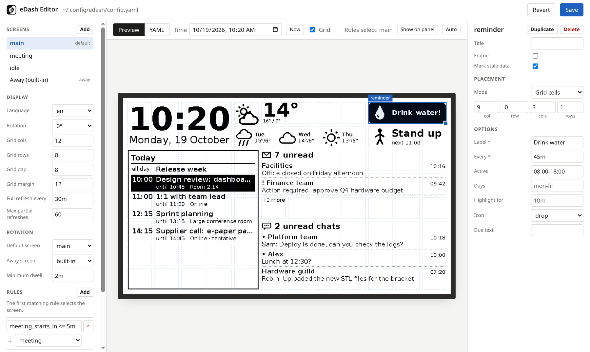
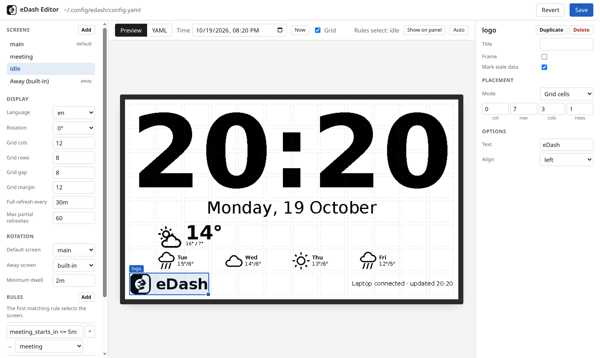

# Host setup

The host (`edash-host`) runs on the laptop. It reads the configuration, fetches data
and sends it to the Pi.

## Windows

```powershell
pip install "edash[host,tray] @ git+https://github.com/PossenigM/edash"
edash-host init-config
notepad $env:APPDATA\edash\config.yaml
edash-host login
edash-host install-autostart
```

`install-autostart` adds a value to `HKCU\Software\Microsoft\Windows\CurrentVersion\Run`
and needs no administrator rights. The Pi appears as two "USB Serial Device (COMx)"
ports. With `host.port: auto`, the host sends a hello on each candidate port and
uses the one that answers.

## Linux

```sh
pip install "edash[host,tray] @ git+https://github.com/PossenigM/edash"
edash-host init-config
edash-host login
edash-host install-autostart
```

`install-autostart` enables a systemd user service and writes a udev rule. The rule
must be installed with the `sudo` command it prints. It:

- creates `/dev/edash` (application port) and `/dev/edash-console` (debug console)
- grants the logged-in user access (`uaccess`)
- excludes the device from ModemManager probing

Without a Secret Service keyring, the login token is stored in a file readable only
by the user, and a warning is logged.

## Configuration file

| OS | Path |
|---|---|
| Windows | `%APPDATA%\edash\config.yaml` |
| Linux | `~/.config/edash/config.yaml` |

`edash-host init-config` copies the example configuration. `edash-host check`
validates it. The host watches the file and pushes changes to the Pi on save. See
[Configuration](configuration.md).

## Layout editor

```sh
edash-host edit
```

Starts a local web server on `127.0.0.1` and opens the editor in the browser. The
editor shows a live preview rendered with sample data by the same code as the Pi.




- Drag widgets to move them, drag the corner handle to resize; arrow keys move the
  selected widget, Delete removes it
- Widget options, display settings, screens and rotation rules are edited in forms
- The time field previews other times of day; the toolbar shows which screen the
  rules select at that time
- The YAML tab shows and edits the raw configuration
- Save validates and writes the file; the previous version is kept as `config.yaml.bak`.
  A running host sends the new layout to the display immediately
- "Show on panel" switches the connected display to the current screen; "Auto" returns
  to rule-based rotation

Saving rewrites the file, so comments in it are not preserved.

## Microsoft Graph

New Outlook has no COM interface. Mail, calendar and Teams data are read through
Microsoft Graph with delegated, read-only permissions: `User.Read`, `Mail.Read`,
`Calendars.Read`, `Chat.Read`.

1. Check user consent: sign in to Graph Explorer with the work account and run
   `GET /me/messages`. "Need admin approval" means the permissions must be approved
   by an administrator.
2. Register an application in the Entra admin center (App registrations → New registration):
   - single tenant
   - platform "Mobile and desktop applications", redirect URI `http://localhost`
   - Authentication → "Allow public client flows" enabled (required for `--device-code`)
   - the four delegated permissions above
3. Set `sources.graph.client_id` to the application (client) ID.
4. Run `edash-host login`, or `edash-host login --device-code` without a local browser.

The token cache is encrypted with DPAPI on Windows and the Secret Service on Linux.
On HTTP 429/503 responses, a source waits for the `Retry-After` interval before the
next request.

Teams channel posts require `ChannelMessage.Read.All`, which always needs admin
consent. Only 1:1 and group chats are supported.

## Away screen

The host reports lock, suspend and shutdown events to the Pi, which then shows the
away screen.

- **Windows**: a hidden window receives session and power broadcasts. Windows allows
  about 2 s at suspend; locking first (Win+L) leaves more time for the refresh.
- **Linux**: events come from systemd-logind over D-Bus. A delay inhibitor holds
  suspend and shutdown for 4 s after the away message, which covers one full refresh.

If USB power drops during a refresh, the panel keeps a partially drawn frame until
the next start.

## Commands

| Command | Function |
|---|---|
| `edash-host run [--tray] [--demo]` | Run the host; `--demo` uses sample data instead of Microsoft 365 |
| `edash-host edit [--port N] [--no-browser]` | Open the layout editor |
| `edash-host preview [--screen ID] [--at TIME] [--scale N]` | Render screens with sample data to PNG |
| `edash-host check` | Validate the configuration |
| `edash-host init-config [--force]` | Copy the example configuration |
| `edash-host login [--device-code]` | Sign in to Microsoft 365 |
| `edash-host ports` | List serial ports that belong to an eDash device |
| `edash-host ctl screen <id>\|auto` | Show a screen, or return to rule-based rotation |
| `edash-host ctl refresh\|fetch\|reload\|status` | Control a running host |
| `edash-host install-autostart`, `uninstall-autostart` | Start the host at login |

`ctl` talks to the running host on `127.0.0.1:47811` (`host.control_port`). The same
port prevents a second host instance from starting. The tray menu offers the `ctl`
commands.
